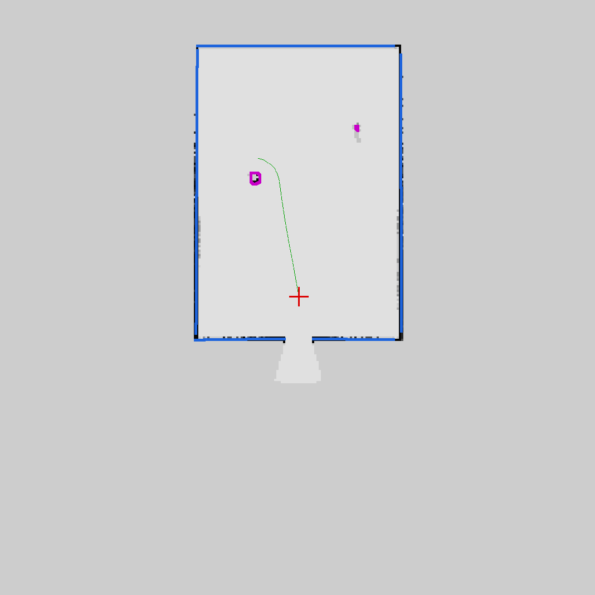
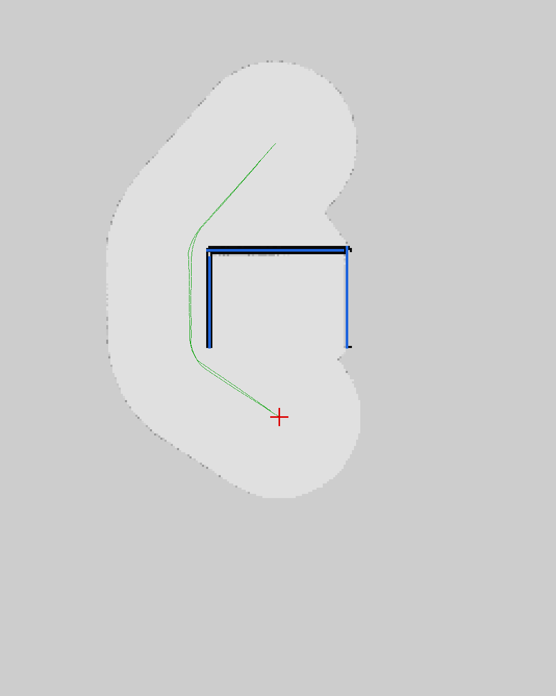
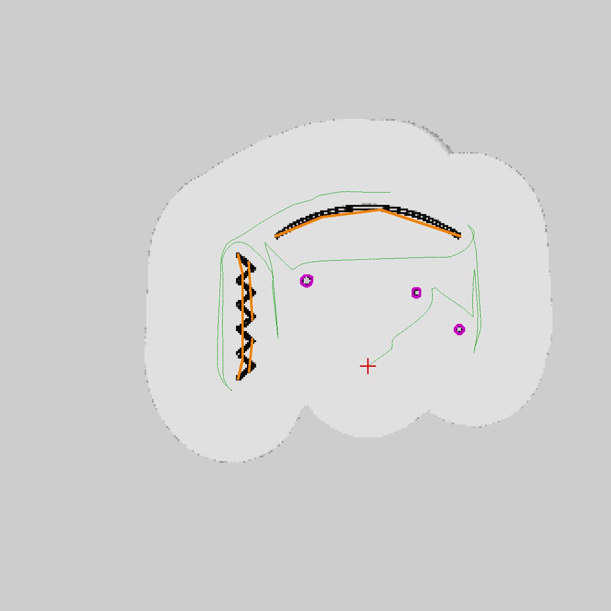

# ros_map — detección, evasión y mapeo de paredes con PX4 v1.17 + ROS 2 Humble

Workspace ROS 2 para un dron con **PX4 v1.17** y una **Jetson con ROS 2
Humble** que:

- **detecta paredes y las esquiva**, tanto planas como irregulares (escombros,
  salientes, curvas, zig-zag, inclinadas), con un lidar 3D o una cámara de
  profundidad;
- tiene una **misión de mapeo** (`/mission/map`): se le da un área, la explora
  sola, **dibuja las paredes en un mapa** clasificadas en *planas*,
  *irregulares* y *obstáculos*, guarda el plano (PNG, SVG con cotas,
  PGM/YAML para nav2, JSON, nube 3D PLY) y vuelve a aterrizar;
- trae **casos de prueba para Unreal** (Cosys-AirSim): un script pone las
  paredes en el mundo y se ve cómo el dron las dibuja. Los mismos casos corren
  sin Unreal (simulador falso con ROS) y sin nada (simulación offline en Python).

Toma como referencia el repo [`UAV_ros2-beta`](https://github.com/Laboratorio-VNT/UAV_ros2-beta)
(misma arquitectura: uXRCE-DDS sin MAVROS, un solo nodo dueño del OFFBOARD,
zanahoria, lógica en Python puro probada sin ROS, Unreal + Cosys-AirSim) y lo
lleva de 5 sensores de distancia fijos a una nube 3D con mapa, planificador y
clasificación de paredes.

| Habitación mapeada (caso 6) | Trampa en U (caso 5) | Curva, zig-zag y columnas (caso 8) |
|---|---|---|
|  |  |  |

*Azul = pared plana, naranja = irregular, magenta = obstáculo, verde = trayectoria,
cruz roja = despegue. Mapas generados por la simulación de lazo cerrado.*

---

## Qué sensor usar

Resumen de [docs/sensores.md](docs/sensores.md): **Livox Mid-360** (lidar 3D
360° × 59°, 265 g) arriba del dron, idealmente inclinado ~20° hacia abajo, más
un rangefinder hacia abajo. Alternativas: **Unitree L2** (más barato, ve por
debajo del dron) o una **cámara de profundidad** al frente (RealSense D435i/D455,
ZED X Mini) con menos alcance y campo visual. Hay un YAML listo para cada caso.

## Documentación

| Documento | Contenido |
|---|---|
| [docs/sensores.md](docs/sensores.md) | Comparativa de sensores, recomendación, cómo conectar cada uno. |
| [docs/casos-de-prueba-unreal.md](docs/casos-de-prueba-unreal.md) | Los 9 casos de prueba en Unreal paso a paso, y cómo poner paredes a mano. |
| [docs/arquitectura.md](docs/arquitectura.md) | Nodos, tópicos, marcos, algoritmos (mapa, paredes, VFH+, A*, fronteras). |
| [docs/jetson-px4-1.17.md](docs/jetson-px4-1.17.md) | Dron real: Jetson, uXRCE-DDS por TELEM2, parámetros de PX4 v1.17, Mid-360, primer vuelo. |
| [docs/evasion-entornos-reales.md](docs/evasion-entornos-reales.md) | Qué hacen PX4, ArduPilot y los planificadores que vuelan de verdad; qué adoptamos (frenado físico, tiempos, filtros, failsafes) y qué no cubrimos. |
| [docs/hardening.md](docs/hardening.md) | Entradas basura y configuración inválida: qué tiraba los nodos, qué se arregló, cómo probarlo (`./run_tests.sh robustez`). |
| [docs/investigacion/](docs/investigacion/) | Reportes completos: código de planificadores reales, autopilotos y entorno real, brechas de este stack. |

---

## Probar en 1 minuto (sin ROS ni Unreal)

Sólo Python 3, numpy y pyyaml:

```bash
git clone --recursive https://github.com/Erolayer-Cl/ros_map.git && cd ros_map
./run_tests.sh rapido                                   # pruebas unitarias (segundos)
./run_tests.sh                                          # + 5 escenarios de vuelo completo (~2 min)
PYTHONPATH=src/uav_wall_mapping:src/uav_mission:src/uav_sim \
  python3 -m uav_sim.closed_loop --escenario 06_habitacion --salida /tmp/mapas
```

La última corre la misión de mapeo completa (despegue, exploración, esquive,
guardado, regreso) contra un lidar simulado y deja el plano en `/tmp/mapas/`.
`--todos` corre los 14 escenarios.

## Instalación (PC de simulación o Jetson)

Ubuntu 22.04 + ROS 2 Humble (en la Jetson: JetPack 6.x). Estructura igual a la
del repo de referencia:

```
UAV_lab/
├── Code/ros_map/            <- este repo
└── dependencias/
    ├── PX4-Autopilot/       (v1.17.0)
    ├── micro/Micro-XRCE-DDS-Agent/
    └── Cosys-AirSim/        (sólo para Unreal)
```

```bash
mkdir -p ~/Workspace/UAV_lab/Code && cd ~/Workspace/UAV_lab/Code
git clone --recursive https://github.com/Erolayer-Cl/ros_map.git && cd ros_map
UNREAL=1 ./setup_workspace.sh          # clona PX4 v1.17.0, el agente y Cosys-AirSim
sudo apt install python3-numpy python3-yaml ros-humble-tf2-ros ros-humble-nav-msgs \
                 ros-humble-visualization-msgs ros-humble-std-srvs ros-humble-foxglove-bridge
source /opt/ros/humble/setup.bash
colcon build --symlink-install
source install/setup.bash
```

PX4 y el Micro XRCE-DDS Agent se compilan como en el repo de referencia (el
script imprime los comandos). **`src/px4_msgs` tiene que coincidir con el
firmware**: es un submódulo en `release/1.17`; con otro firmware, re-sincronizar
(ver [docs/jetson-px4-1.17.md](docs/jetson-px4-1.17.md) §2.1).

## Simulación con ROS, sin Unreal

```bash
./launch_fake_sim.sh 06_habitacion                       # PX4 + lidar falsos, mapper, misión
ros2 service call /mission/map std_srvs/srv/Trigger     # en otra terminal
ros2 launch foxglove_bridge foxglove_bridge_launch.xml   # y Foxglove en ws://localhost:8765
```

`AUTO=true ./launch_fake_sim.sh 05_trampa_U` arranca sola la misión del escenario.

## Simulación con Unreal

Ver [docs/casos-de-prueba-unreal.md](docs/casos-de-prueba-unreal.md). En corto:

```bash
cp src/uav_sim/airsim/settings.json /mnt/c/Users/<usuario>/Documents/AirSim/settings.json
ESCENARIO=06_habitacion ./launch_sim_unreal.sh           # Unreal ya en Play
ros2 run uav_sim spawn_scenario --escenario 06_habitacion --limpiar   # pone las paredes
ros2 service call /mission/map std_srvs/srv/Trigger
```

## Evasión en entornos reales

La simulación sin latencia ni ruido escondía fallas que en un vuelo real
chocan (ver [docs/evasion-entornos-reales.md](docs/evasion-entornos-reales.md),
con el código de PX4, ArduPilot, EGO-Planner, PX4-Avoidance, KR y otros de
donde sale cada idea):

- **Frenado físico**: velocidad máxima `v = −a·t + √((a·t)² + 2·a·d)` con `d`
  libres en el corredor de avance y `t` = latencia + edad del dato
  (`avoid.max_decel` 1 m/s², `avoid.latency` 0.4 s, como `CP_DELAY` de PX4).
- **Tiempos**: cada nube con la pose de su captura (historial de poses con
  slerp), sectores recalculados contra la pose actual, edad del dato en el
  frenado, timeouts de 0.4-0.5 s. Requiere `UXRCE_DDS_SYNCT=1`.
- **Techo**: la grilla 2D llega a 1 m sobre el dron, no a 8 m sobre el despegue.
- **Filtros**: caja del propio dron (`self_filter.box`), puntos aislados
  (polvo, insectos), 2.º punto por sector; la huida la dispara sólo el sensor
  en vivo y va únicamente hacia sectores vistos (con cámara, gira antes de
  avanzar fuera de la vista).
- **Failsafes**: sin pose → frenar y aterrizar a los 2 s; sin sensor → frenar y
  aterrizar a los 10 s; RETURN imposible → aterrizar; geocerca blanda; altura
  mínima/máxima.
- **Ojo:** la Collision Prevention de PX4 **no actúa en Offboard**.
- Escenarios de entorno real en `uav_sim` (latencia, cabeceo, polvo,
  auto-impactos, viento, obstáculo súbito, techo, puerta de 2 m, postes finos).

Lo que no cubre: vidrio, cables finos, deskew por punto (usar FAST-LIO2),
evasión vertical.

## Dron real

Ver [docs/jetson-px4-1.17.md](docs/jetson-px4-1.17.md):

```bash
MicroXRCEAgent serial --dev /dev/ttyTHS1 -b 921600
ros2 launch livox_ros_driver2 msg_MID360_launch.py
ros2 launch uav_wall_mapping mapper.launch.py \
  config:=$(ros2 pkg prefix uav_wall_mapping)/share/uav_wall_mapping/config/mapper_mid360.yaml
ros2 launch uav_mission mission.launch.py
```

---

## Uso

### Servicios (`std_srvs/srv/Trigger`)

| Servicio | Qué hace |
|---|---|
| `/mission/start` | Vuela los `waypoints` (norte, este, altura relativos al despegue) esquivando paredes. |
| `/mission/map` | **Misión de mapeo** del área `map_mission.area`: explora, dibuja, guarda y vuelve. |
| `/mission/pause` / `/mission/resume` | Mantener posición / seguir. |
| `/mission/cancel` | Volver al despegue y aterrizar. |
| `/mission/abort` | Aterrizar donde está. |
| `/map/save` | Guardar el mapa ahora (`output_dir`, por defecto `~/ros_map_mapas`). |
| `/map/reset` | Borrar el mapa. |

El área y la altura se cambian en `src/uav_mission/config/mission.yaml` o en vuelo:

```bash
ros2 param set /mission_node map_mission.area "[-5.0, -15.0, 25.0, 15.0]"   # N_min, E_min, N_max, E_max
ros2 param set /mission_node map_mission.strategy lawnmower                  # o frontier
```

### Tópicos principales

| Tópico | Tipo | Contenido |
|---|---|---|
| `/map` | `nav_msgs/OccupancyGrid` | Plano 2D (frame `map`, ENU). |
| `/walls` | `uav_map_msgs/WallArray` | Paredes con tipo, vértices (NED), largo, alturas, inclinación. |
| `/walls/markers` | `visualization_msgs/MarkerArray` | Paredes en 3D coloreadas por tipo, con etiqueta. |
| `/map/cloud` | `sensor_msgs/PointCloud2` | Mapa 3D. |
| `/obstacles/sectors` | `uav_map_msgs/ObstacleSectors` | 72 sectores de distancia para la evasión. |
| `/mission/status` | `uav_map_msgs/MissionStatus` | Estado, distancias, cobertura, paredes contadas. |
| `/mission/path` | `nav_msgs/Path` | Camino A* actual. |

### Tópicos de PX4 v1.17 (uXRCE-DDS)

Entrada: `/fmu/out/vehicle_local_position_v1`, `/fmu/out/vehicle_status_v1`
(**con sufijo `_v1`**: en v1.17 estos mensajes tienen `MESSAGE_VERSION = 1`),
`/fmu/out/vehicle_attitude`. Salida (sólo `mission_node`):
`/fmu/in/trajectory_setpoint`, `/fmu/in/offboard_control_mode`,
`/fmu/in/vehicle_command`; y opcionalmente (`mapper_node`)
`/fmu/in/obstacle_distance` para la Collision Prevention de PX4.

---

## Estructura

```
src/
├── px4_msgs/            submódulo, release/1.17
├── uav_map_msgs/        MissionStatus, Wall, WallArray, ObstacleSectors
├── uav_wall_mapping/    mapper_node + occupancy, walls, sectors, export, geometry, cloud
│   └── config/          mapper_unreal.yaml, mapper_mid360.yaml, mapper_realsense.yaml
├── uav_mission/         mission_node + mission_core, avoidance (VFH+), planner (A*), exploration
│   └── config/          mission.yaml
└── uav_sim/             escenarios, world (lidar simulado), closed_loop, fake_px4_world, spawn_unreal
    ├── scenarios/       01_pared_plana … 09_barrido_exterior
    └── airsim/          settings.json de Cosys-AirSim con lidar
docs/                    sensores, casos de prueba Unreal, arquitectura, Jetson + PX4 1.17
launch_sim_unreal.sh, launch_fake_sim.sh, stop_sim.sh, setup_workspace.sh, run_tests.sh
```

## Estado de la verificación

- Pruebas unitarias (geometría, nubes, grilla, sectores, paredes, VFH+, A*,
  frenado, historial de poses, filtros, failsafes, exploración, máquina de
  estados) y los **14 escenarios de lazo cerrado** (5 de ellos con condiciones
  de entorno real): pasan (`./run_tests.sh`, `TODOS=1 ./run_tests.sh`). Choque =
  centro del dron a menos de su radio (0.45 m); la distancia mínima a las
  paredes quedó por encima de 0.7 m.
- Los tres nodos ROS se ejercitaron juntos sobre un ROS simulado en memoria
  (misión de mapeo y de waypoints completas, mapa guardado vía `/map/save`).
- **Pendiente de probar en un entorno ROS 2 Humble real, en Unreal y en vuelo**:
  `colcon build` y los launch no se pudieron ejecutar en el entorno donde se
  escribió el código. Los nombres de tópicos y campos de PX4 v1.17 se
  verificaron contra `px4_msgs` `release/1.17` y el código fuente de PX4 v1.17.0;
  los de Cosys-AirSim, contra su wrapper ROS 2.
