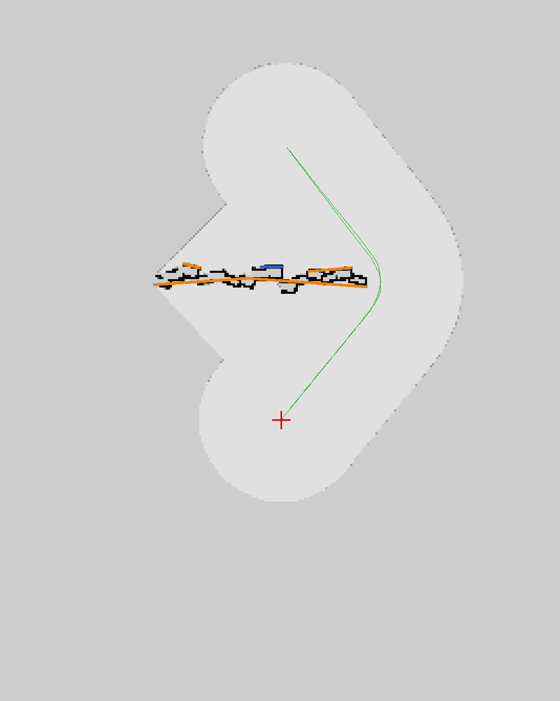
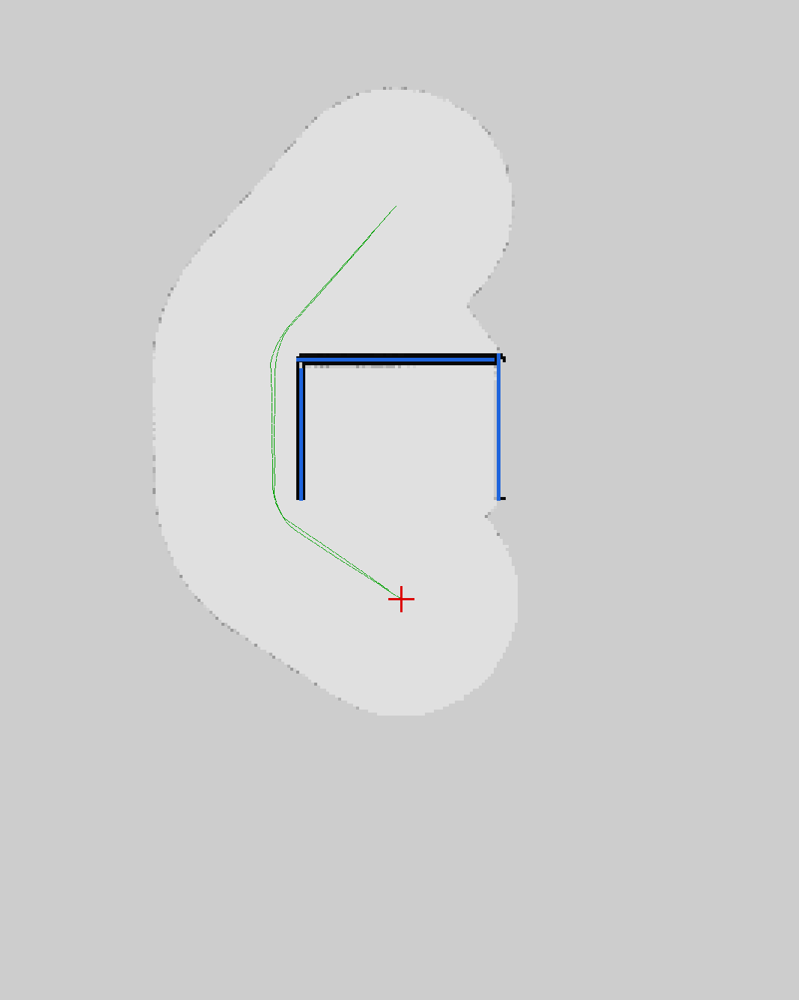
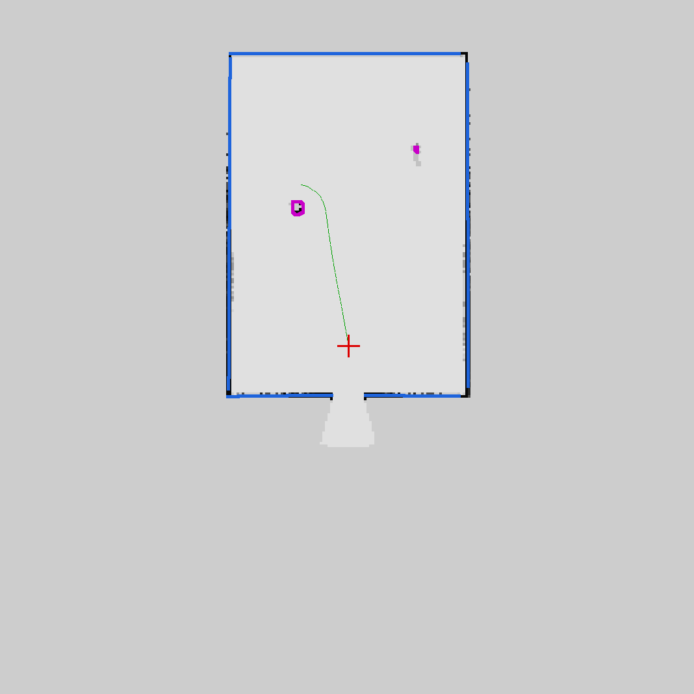
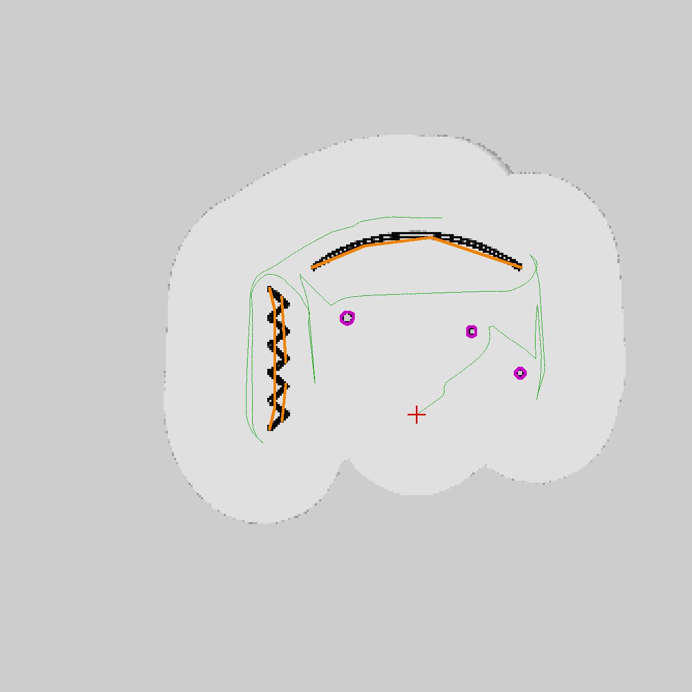

# Casos de prueba: poner paredes en Unreal y ver cómo el dron las dibuja

Esta guía arma, paso a paso, las pruebas en Unreal Engine + Cosys-AirSim + PX4
v1.17 SITL. Cada caso es un escenario YAML de `src/uav_sim/scenarios/`: **el
mismo archivo** crea las paredes en Unreal (`spawn_scenario`), alimenta al
simulador sin GPU (`fake_px4_world`) y a la simulación offline
(`sim_offline`). Así cada prueba se puede correr primero en segundos en
cualquier PC y después confirmar en Unreal sobre la misma geometría.

La instalación de Unreal, Cosys-AirSim y PX4 SITL es la misma del repo de
referencia `UAV_ros2-beta` (`docs/migracion-gazebo-a-unreal.md`): GameMode
Override = `AirSimGameMode`, Visual Studio Build Tools 2022, `libc++-dev`, y
todos los parámetros de `airsim_node` explícitos. Acá sólo cambia el
`settings.json` (se agrega el lidar) y lo que se lanza encima.

---

## 0. Orden recomendado para probar

1. **Offline, sin ROS ni Unreal** (segundos, cualquier PC con Python 3 + numpy + pyyaml):
   ```bash
   ./run_tests.sh                                      # todo
   PYTHONPATH=src/uav_wall_mapping:src/uav_mission:src/uav_sim \
     python3 -m uav_sim.closed_loop --escenario 06_habitacion --salida /tmp/mapas
   ```
   Deja en `/tmp/mapas` el PNG/SVG/JSON del mapa que *debería* salir en Unreal.
2. **ROS 2 sin Unreal** (prueba los nodos de verdad, sin GPU):
   ```bash
   ./launch_fake_sim.sh 06_habitacion
   ros2 service call /mission/map std_srvs/srv/Trigger
   ```
3. **Unreal**: lo de esta guía.

---

## 1. Preparar Unreal (una sola vez)

1. Copiar `src/uav_sim/airsim/settings.json` a
   `C:\Users\<usuario>\Documents\AirSim\settings.json`. Respecto del repo de
   referencia agrega un sensor `"lidar"` (SensorType 6) que imita un Livox
   Mid-360: 16 canales, −7° a +52°, 360 mediciones por vuelta, 10 Hz, 40 m.
   - El bloque `Sensors` **reemplaza** los sensores por defecto: por eso
     Barometer/Imu/Gps/Magnetometer siguen explícitos. Sin ellos PX4 no arma.
   - `"DrawDebugPoints": true` dibuja los impactos del lidar en el viewport:
     útil para ver qué está viendo el dron (cuesta FPS).
   - Si se inclina el lidar (`"Pitch": -20`), pasar el mismo valor al launch:
     `LIDAR_PITCH=-20 ./launch_sim_unreal.sh` (si no, el mapa sale torcido).
2. Usar un mapa plano y despejado (el mapa por defecto del proyecto, o Blocks
   de Cosys-AirSim después de borrar los bloques alrededor del PlayerStart):
   las paredes de las pruebas se crean por script a 2-25 m del PlayerStart.
3. Cliente Python de Cosys-AirSim, del lado de WSL2:
   ```bash
   pip install --user cosysairsim pyyaml   # o: pip install -e ~/Workspace/UAV_lab/dependencias/Cosys-AirSim/PythonClient
   ```

## 2. Cada vez

```bash
cd ~/Workspace/UAV_lab/Code/ros_map
ESCENARIO=06_habitacion ./launch_sim_unreal.sh     # Unreal ya en Play
```

En la ventana `stack` de tmux quedan los comandos:

```bash
ros2 run uav_sim spawn_scenario --escenario 06_habitacion --limpiar   # crea las paredes
ros2 service call /mission/map std_srvs/srv/Trigger                   # o /mission/start
ros2 topic echo /mission/status --field message
```

El mapa queda en `~/ros_map_mapas/mapa_<fecha>.{png,svg,pgm,yaml,_walls.json,_cloud.ply}`.

### Qué mirar en Foxglove (`ws://localhost:8765`)

| Panel | Tópico | Qué muestra |
|---|---|---|
| 3D | `/map` | El plano 2D: blanco libre, negro ocupado, gris desconocido. |
| 3D | `/walls/markers` | Paredes como "cercas": **azul = plana, naranja = irregular, magenta = obstáculo**, con etiqueta `P<id> tipo largo (inclinación)`. |
| 3D | `/map/cloud` | Nube 3D acumulada, coloreada por altura. |
| 3D | `/mission/path` | Camino A* actual. |
| 3D | `/obstacles/scan` | Los 72 sectores que usa la evasión, alrededor del dron. |
| 3D | `/airsim_node/PX4/lidar/points/lidar` | La nube cruda del lidar (frame `PX4/lidar`). |
| Plot | `/mission/status.obstacle_distance`, `.ground_speed`, `.coverage` | Cuánto se acerca a las paredes, a qué velocidad, cuánto lleva mapeado. |
| Raw | `/mission/status` | Estado, mensaje, paredes contadas. |

---

## 3. Los casos

Cada caso dice qué geometría se crea, qué misión lanzar, qué tiene que pasar y
cómo se ve que pasó. Entre paréntesis, el resultado de la simulación offline
(lidar simulado sin ruido de física): es la referencia contra la que comparar
Unreal.

### Caso 1 — Pared plana (`01_pared_plana`)

- **Geometría:** pared recta de 14 m × 5 m, 30 cm de espesor, a 10 m al norte.
- **Misión:** `/mission/start` (waypoint en N=20, del otro lado).
- **Tiene que pasar:** despega, ve la pared, la rodea por el extremo más corto
  sin acercarse a menos de ~1 m, llega al waypoint, vuelve y aterriza.
- **Mapa:** 1 pared **plana** (azul) de ~14 m, inclinación ~0°.
  *(offline: DONE, 1 plana, distancia mínima 1.0 m)*

### Caso 2 — Pared irregular de escombros (`02_pared_irregular`)

- **Geometría:** 15 bloques de 1 m con salientes de hasta 0.6 m, girados ±20° y
  de altura variable (semilla fija: la misma pared en Unreal y offline).
- **Misión:** `/mission/start`.
- **Tiene que pasar:** igual que el caso 1, sin "meterse" entre salientes.
- **Mapa:** la pared aparece **irregular** (naranja), como una polilínea que
  sigue los salientes (puede quedar algún bloque suelto plano).
  *(offline: DONE, 3 irregulares + 1 plana, mínima 0.96 m)*



### Caso 3 — Esquina en L (`03_esquina_L`)

- **Geometría:** dos paredes planas a 90°.
- **Misión:** `/mission/map` (área 20 × 22 m).
- **Mapa:** 2 paredes planas que se tocan en la esquina; la esquina no genera
  una "pared irregular" chica (se descarta como artefacto).
  *(offline: DONE, 2 planas, cobertura 100 %)*

### Caso 4 — Pasillo (`04_pasillo`)

- **Geometría:** pasillo de 4 m × 20 m: pared plana al oeste, de escombros al este.
- **Misión:** `/mission/start` (waypoint al final del pasillo).
- **Tiene que pasar:** cruza por el medio (el A* paga extra cerca de las
  paredes), sin bajar de 1.5 m de distancia a ninguna.
- **Mapa:** 1 plana de 20 m + 1 irregular de 20 m.
  *(offline: DONE, mínima 1.56 m)*

### Caso 5 — Trampa en U (`05_trampa_U`)

- **Geometría:** U de 10 × 7 m abierta hacia el dron; el waypoint está detrás.
- **Misión:** `/mission/start`.
- **Tiene que pasar:** **no se mete en la U.** En cuanto el lidar ve el fondo,
  el A* sobre el mapa traza un camino por fuera. Un esquive sólo reactivo
  (como el del repo de referencia) entraría y quedaría oscilando o se rendiría.
- **Mapa:** 3 paredes planas.
  *(offline: DONE, 3 planas, mínima 1.09 m)*



### Caso 6 — Habitación (`06_habitacion`) ← el caso principal de mapeo

- **Geometría:** habitación de 20 × 14 m, paredes de 4 m, una puerta de 2 m al
  sur, una columna (cilindro) y una caja de 1.2 × 1.2 × 1.5 m adentro.
- **Misión:** `/mission/map` (área = la habitación).
- **Tiene que pasar:** despega, gira 360°, explora por fronteras lo que falte
  ver (detrás de la columna y la caja), guarda el mapa, vuelve y aterriza.
- **Mapa:** 4 paredes (la sur partida en dos por la **puerta, que se respeta**),
  la columna y la caja como **obstáculos**.
  *(offline: DONE en ~35 s, 5 planas + 2 obstáculos)*



### Caso 7 — Pared inclinada (`07_pared_inclinada`)

- **Geometría:** pared inclinada 20° hacia el dron junto a una a plomo.
- **Misión:** `/mission/map`.
- **Mapa:** las dos son **planas**, pero la inclinada lleva su inclinación en la
  etiqueta y en el JSON (`inclinacion_deg` ≈ 18-20°). En planta su huella es más
  ancha: se proyecta toda la franja de alturas, así que el dron no se acerca a
  la parte de arriba que sobresale.
  *(offline: DONE, inclinación medida 18°)*

### Caso 8 — Curva, zig-zag y columnas (`08_curva_columnas_dentada`)

- **Geometría:** arco de 13 m de radio, pared dentada en zig-zag y tres columnas.
- **Misión:** `/mission/map`.
- **Mapa:** curva y zig-zag **irregulares** (la curva se distingue de una recta
  por la flecha de la parábola ajustada), columnas como **obstáculos**.
  *(offline: DONE, 0 planas, irregulares + 3 obstáculos)*



### Caso 9 — Exterior con barrido (`09_barrido_exterior`)

- **Geometría:** área abierta de 30 × 28 m con paredes sueltas y una caja girada.
- **Misión:** `/mission/map` con `strategy: lawnmower` (zig-zag cada 8 m).
- **Para qué:** comparar estrategias. El barrido es predecible y repetible; la
  exploración por fronteras suele ser más corta.

---

## 4. Caso libre: poner las paredes a mano en el editor

Para probar con cualquier forma (no hace falta YAML):

1. En el editor de Unreal: **Place Actors → Shapes → Cube** (o Cylinder), y
   arrastrarlo delante del PlayerStart. El cubo básico mide 1 m: con **Scale**
   se le da el tamaño (ej. X=10, Y=0.3, Z=4 → pared de 10 m × 30 cm × 4 m).
   Rotarlo, inclinarlo, combinar varios para formas irregulares.
2. Verificar que tenga colisión (*Collision Presets* ≠ `NoCollision`): el lidar
   de AirSim es un raycast sobre el canal `Visibility`, y un actor sin
   colisión es invisible para él.
3. Play, y:
   ```bash
   ./launch_sim_unreal.sh                       # sin ESCENARIO
   # definir el área a mapear (relativa al despegue: N_min, E_min, N_max, E_max)
   ros2 param set /mission_node map_mission.area "[-5.0, -15.0, 25.0, 15.0]"
   ros2 service call /mission/map std_srvs/srv/Trigger
   ```
   Para ubicar paredes de un YAML a mano en vez de con el script:
   `ros2 run uav_sim spawn_scenario --escenario 02_pared_irregular --mostrar`
   lista cada pieza con Location (cm, X=norte, Y=este, Z=arriba), Rotation y
   Scale listos para copiar en el panel *Details*.

## 5. Escenarios propios

Copiar un YAML de `src/uav_sim/scenarios/` y editarlo (tipos `caja`,
`cilindro`, `pared`, `pared_irregular`, `pared_dentada`, `pared_curva`; ver el
docstring de `uav_sim/scenario.py`). Recompilar (`colcon build --packages-select uav_sim`)
o pasar la ruta completa: `spawn_scenario --escenario /ruta/mi_caso.yaml`.
Conviene correrlo primero offline (`sim_offline --escenario /ruta/mi_caso.yaml`)
y agregar un bloque `esperado:` para que `run_tests.sh` lo verifique siempre.

---

## 6. Problemas típicos

| Síntoma | Causa probable | Qué hacer |
|---|---|---|
| `/mission/map` responde "no llegan datos de obstáculos" | `airsim_node` no publica el lidar, o el mapper no lo recibe | `ros2 topic hz /airsim_node/PX4/lidar/points/lidar` dentro de la sesión tmux. ¿Está el sensor `lidar` en settings.json? ¿Se reinició Unreal después de cambiarlo? |
| "todavía no hay posición local válida de PX4" | Tópico sin el sufijo de versión o PX4 sin EKF | En PX4 v1.17 es `/fmu/out/vehicle_local_position_v1`. `ros2 topic list \| grep fmu/out`. |
| Las paredes salen espejadas o giradas | Montaje del lidar distinto entre settings.json y `cloud.mount_*` | Mismos X/Y/Z/Roll/Pitch/Yaw en los dos lados (y `LIDAR_PITCH`). |
| Paredes "fantasma" pegadas al dron | El lidar choca contra el propio dron | Subir `map.min_range` (0.5 m por defecto) o alejar el lidar del cuerpo. |
| Las paredes del escenario no aparecen en Unreal | Asset distinto o pivote en la base | `spawn_scenario --asset-caja <nombre>` (ver `simListAssets`), `--pivote base`. |
| Las paredes aparecen flotando o enterradas | El piso no está donde se estimó | `--suelo-d <D>`; el script ya entierra 0.5 m cada pieza. |
| El dron no despega | Preflight checks / RC | `COM_RCL_EXCEPT=4` y `NAV_RCL_ACT=0` ya están en settings.json; ver QGroundControl. |
